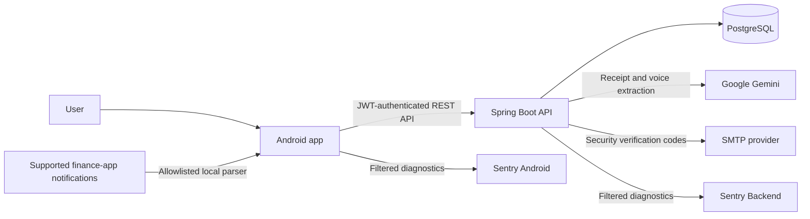

<h1 align="center">WiseKoin</h1>

<p align="center">
  <strong>A privacy-conscious personal finance platform for Android.</strong><br />
  Track everyday money activity, understand cash flow, plan goals and debts, and review AI-assisted transaction suggestions.
</p>

<p align="center">
  <a href="https://wisekoin.pages.dev/">Website</a> ·
  <a href="https://github.com/WiseKoin/Frontend">Frontend</a> ·
  <a href="https://github.com/WiseKoin/Backend">Backend</a> ·
  <a href="https://wisekoin.pages.dev/support.html">Support</a>
</p>

<p align="center">
  
</p>

## About WiseKoin

WiseKoin is an end-to-end personal finance application built around a native Android client and a secure Spring Boot API. It helps users maintain wallets, record income and expenses, understand cash flow, plan savings, track debts, and reduce repetitive entry with review-first AI assistance.

WiseKoin is a recordkeeping and planning tool. It is **not** a bank, wallet provider, payment processor, lender, or investment service. Balances shown in the app are user records and do not represent funds held by WiseKoin.

## Our repositories

| Repository | What it contains | Main technologies |
| --- | --- | --- |
| [**Frontend**](https://github.com/WiseKoin/Frontend) | Native Android application, device integrations, landing page, support center, and legal-document workspace | Kotlin, Jetpack Compose, Retrofit, OkHttp, CameraX |
| [**Backend**](https://github.com/WiseKoin/Backend) | REST API, authentication, financial business rules, PostgreSQL persistence, AI orchestration, scheduled jobs, and API documentation | Java 21, Spring Boot 4, Spring Security, JPA, Flyway |

The repositories are deliberately separate. Android concerns remain in `Frontend`; server-side authorization, ownership checks, persistence, and balance-changing rules remain in `Backend`. API contract changes must be coordinated and tested across both.

## Product capabilities

- **Secure accounts:** registration, login, rotating refresh tokens, logout, profile updates, password recovery, purpose-bound email OTP, and verified account deletion.
- **Financial records:** wallets, income, expenses, transfers, categories, notes, dates, filters, pagination, and monthly summaries.
- **Planning tools:** savings goals and funding history, debts and repayments, plus backend-managed recurring expenses.
- **AI-assisted entry:** extract proposed transaction details from receipt images or voice recordings through Google Gemini, then review before saving.
- **Notification suggestions:** optionally parse supported VCB Digibank, MB Bank, Techcombank Mobile, and MoMo notifications locally on Android.
- **Reliability controls:** transactional balance updates, idempotent creation, duplicate-upload detection, validation, ownership enforcement, and rate limiting.
- **Support and diagnostics:** in-app user feedback and separate privacy-filtered Sentry projects for the Android app and API.

The base currency is an account display preference. WiseKoin does not currently provide live exchange rates or promise automatic currency conversion.

## Architecture



### Frontend responsibilities

- Compose UI, navigation, accessibility, and presentation state
- Retrofit API clients and coordinated access-token refresh
- Android Keystore-backed encrypted session and notification-candidate storage
- Receipt capture, voice recording, and temporary media cleanup
- Local notification allowlisting, parsing, redaction, and user review
- Explicit confirmation before a suggestion becomes a financial transaction

### Backend responsibilities

- Stateless JWT authentication and rotating, hashed refresh tokens
- BCrypt password storage and purpose-bound, hashed OTP challenges
- User-scoped authorization for every owned resource
- Transactional wallet, transaction, goal-funding, and debt-repayment rules
- PostgreSQL persistence and append-only Flyway schema migrations
- Recurring-expense scheduling and idempotent financial writes
- Bounded Gemini calls, AI suggestion lifecycle, and category feedback
- Structured errors, validation, request throttling, and server telemetry

## Repository layouts

### Frontend

```text
Frontend/
├── app/
│   └── src/
│       ├── main/
│       │   ├── kotlin/com/wisekoin/
│       │   │   ├── data/
│       │   │   │   ├── local/          # Encrypted tokens and notification queue
│       │   │   │   ├── model/          # API and UI-domain models
│       │   │   │   ├── remote/         # Retrofit services and network handling
│       │   │   │   └── repository/     # Data-access boundaries
│       │   │   ├── di/                 # Application container and factories
│       │   │   ├── navigation/         # Compose navigation graph
│       │   │   ├── notification/       # Allowlisted parsers and sync pipeline
│       │   │   ├── ui/                 # Screens, components, and theme
│       │   │   ├── util/               # Money, time, and file utilities
│       │   │   └── viewmodel/          # StateFlow presentation logic
│       │   ├── res/                     # Android resources and fonts
│       │   └── AndroidManifest.xml
│       ├── test/                        # JVM unit tests
│       └── androidTest/                 # Device and Compose UI tests
├── legal/                               # Website, support, audits, and legal drafts
├── gradle/                              # Version catalog and wrapper configuration
├── .github/workflows/                   # Android CI and release automation
├── build.gradle.kts
└── settings.gradle.kts
```

### Backend

```text
Backend/
├── src/
│   ├── main/
│   │   ├── java/com/wisekoin/backend/
│   │   │   ├── config/                  # Security and application configuration
│   │   │   └── module/
│   │   │       ├── ai/                  # Suggestion lifecycle and AI metadata
│   │   │       ├── auth/                # Login, JWT, refresh tokens, and security
│   │   │       ├── category/            # User-owned transaction categories
│   │   │       ├── common/              # Shared errors and infrastructure
│   │   │       ├── debt/                # Debts and repayments
│   │   │       ├── goal/                # Savings goals and funding
│   │   │       ├── receipt/             # Receipt-image extraction
│   │   │       ├── recurring/           # Monthly recurring expenses
│   │   │       ├── transaction/         # Financial entries and balance events
│   │   │       ├── user/                # Profiles, OTP, currency, deletion
│   │   │       ├── voice/               # Voice transaction extraction
│   │   │       └── wallet/              # Wallet records and balances
│   │   └── resources/
│   │       ├── ai/prompts/               # Versioned receipt and voice prompts
│   │       ├── db/migration/             # Append-only Flyway migrations
│   │       └── application.properties    # Environment-backed configuration
│   └── test/                             # Service, controller, and security tests
├── evaluation/
│   └── vietnamese-ai-corpus/             # Versioned receipt, speech, and safety cases
├── .github/workflows/                    # Tests, formatting, and Docker publishing
├── .env.development.example
├── .env.production.example
├── docker-compose.yml                    # Development stack with Neon Local
├── docker-compose.prod.yml               # Production application stack
├── Dockerfile
└── pom.xml
```

## Technology

| Area | Technologies |
| --- | --- |
| Android | Kotlin 2.1, Jetpack Compose, Material 3, Navigation Compose, ViewModel/StateFlow |
| Networking | Retrofit, OkHttp, Gson, JWT access and rotating refresh tokens |
| Device features | CameraX, audio recording, notification listener, Android Keystore |
| Backend | Java 21, Spring Boot 4.1, Spring MVC, Spring Security, Jakarta Validation |
| Data | PostgreSQL, Spring Data JPA, Hibernate, Flyway, `BigDecimal` monetary values |
| AI assistance | Google Gemini with versioned prompts and a review-first suggestion lifecycle |
| Observability | Dedicated Sentry projects for Android and backend |
| Delivery | Gradle, Maven Wrapper, Docker, GitHub Actions, Cloudflare Pages |

## API surface

The backend exposes authenticated REST resources under `/api`:

| Area | Main routes |
| --- | --- |
| Authentication | `/api/auth/register`, `/login`, `/refresh`, `/logout` |
| Account security | `/api/users/me`, `/password`, `/base-currency`, `/otp/*` |
| Financial records | `/api/wallets`, `/categories`, `/transactions` |
| Planning | `/api/recurring-transactions`, `/debts`, `/goals` |
| AI extraction | `/api/receipts/extract`, `/api/voice/extract` |
| Suggestions | `/api/ai/suggestions` and notification-suggestion routes |

See the [Backend README](https://github.com/WiseKoin/Backend#rest-api-endpoints) for the complete contract. Local Swagger UI is available at `http://localhost:8080/swagger-ui.html` while the API is running.

## Privacy and security principles

- The backend derives resource ownership from the authenticated principal; clients do not select an owning user ID.
- Refresh tokens and OTP values are stored as hashes. Android credentials use Keystore-backed encrypted storage.
- Password changes and account deletion require the current password and a short-lived email verification token.
- Receipt and voice uploads are bounded and content-checked. The backend does not retain raw media, transcripts, base64 content, or AI-provider payloads.
- Original finance-notification text is parsed and discarded on-device. Only a small typed, redacted candidate can be synchronized.
- AI and notification results are suggestions and do not modify balances until the user confirms them.
- Sentry is configured to avoid automatic collection of financial bodies, authentication headers, cookies, and user identity enrichment.

Read the code-backed [privacy data-flow audit](https://github.com/WiseKoin/Frontend/blob/main/legal/04_PRIVACY_DATA_FLOW_AUDIT.md) for the detailed inventory across both repositories.

## Getting started

### Prerequisites

- Java 21
- Android Studio and Android SDK 36
- Docker Desktop or PostgreSQL
- Android 7.0/API 24 or newer

### Clone the platform

```powershell
git clone https://github.com/WiseKoin/Backend.git wisekoin-backend
git clone https://github.com/WiseKoin/Frontend.git wisekoin-android
```

### Run the backend

```powershell
cd wisekoin-backend

$env:DB_URL = "jdbc:postgresql://localhost:5432/wisekoin"
$env:DB_USERNAME = "postgres"
$env:DB_PASSWORD = "replace-me"
$env:JWT_SECRET = "replace-with-at-least-32-random-bytes"

.\mvnw.cmd spring-boot:run
```

Flyway creates or updates the schema at startup. Gemini features additionally require `VISION_LANGUAGE_API_KEY`; OTP delivery requires the documented SMTP values. See the backend [environment template](https://github.com/WiseKoin/Backend/blob/main/.env.development.example) for all supported settings.

### Run the Android app

```powershell
cd ..\wisekoin-android
.\gradlew.bat installDebug
```

The emulator build defaults to `http://10.0.2.2:8080/`. For a physical device, configure a backend address reachable from the phone:

```powershell
$env:WISEKOIN_DEBUG_API_BASE_URL = "http://192.168.1.10:8080/"
.\gradlew.bat installDebug
```

Never commit `.env` files, database credentials, JWT secrets, provider keys, Sentry tokens, signing keystores, or production URLs.

## Testing

### Frontend

```powershell
.\gradlew.bat testDebugUnitTest
.\gradlew.bat lintDebug
.\gradlew.bat assembleDebug
```

### Backend

```powershell
.\mvnw.cmd test
.\mvnw.cmd spotless:check
```

Run each command from its corresponding repository. Device tests are available through `connectedDebugAndroidTest`; backend tests keep remote AI calls mocked and use isolated test configuration.

## Project links

- [Product website](https://wisekoin.pages.dev/)
- [Support Center](https://wisekoin.pages.dev/support.html)
- [Frontend repository](https://github.com/WiseKoin/Frontend)
- [Backend repository](https://github.com/WiseKoin/Backend)
- [Backend API documentation](https://github.com/WiseKoin/Backend#rest-api-endpoints)
- [AI feature audit](https://github.com/WiseKoin/Backend/blob/main/AI_FEATURE_AUDIT.md)
- [Terms of Service—review draft](https://wisekoin.pages.dev/terms.html)
- [Privacy Policy—review draft](https://wisekoin.pages.dev/privacy.html)

The hosted legal documents remain review drafts with unresolved placeholders. They must not be treated as final policies until the publication checklist is complete and qualified counsel approves them.

## Contributing

Please read the `AGENTS.md` contributor guide in the repository you are changing. Preserve API compatibility unless both repositories are deliberately updated, keep financial values as `BigDecimal`, add focused tests for changed behavior, and keep all secrets outside version control.

## License

The organization repositories do not currently declare an open-source license. Unless the project owner states otherwise, all rights are reserved.
